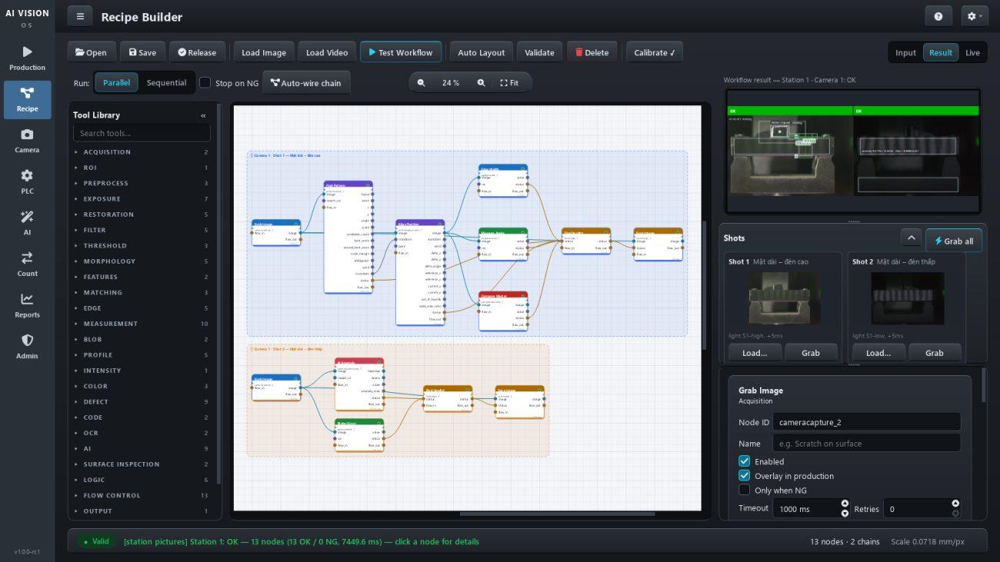
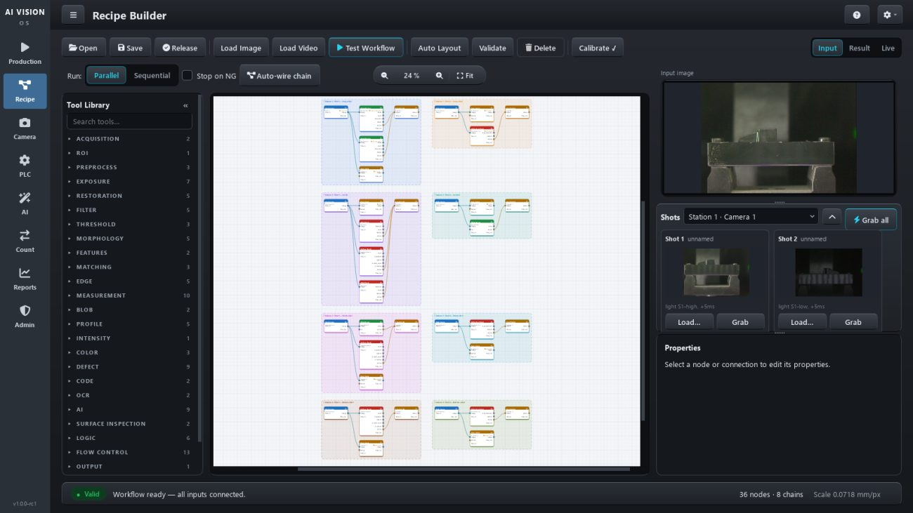

<div align="center">


# AI Vision OS

**Visual inspection software for production lines: drag‑and‑drop workflows, cameras, PLCs and AI in one application.**


[Tiếng Việt](README.md) · **English**

🌐 **Website:** https://hntan0104.github.io/AI-Vision-OS/?lang=en


</div>

---

With AI Vision OS, engineers build an **inspection recipe** for each product by
dragging tools into a graph, **with no code**:

```
PLC trigger → Capture (multiple shots, multiple lights) → Locate → Measure / find defects / AI
            → OK/NG verdict → Result to the PLC → Save image + data
```

One PC runs **up to 4 inspection stations**, each with its own camera and recipe,
all sharing one PLC.

## Main features

| Screen | What it does |
|---|---|
| **Production** | Operator screen: image and OK/NG result per station and per shot; output statistics, defect Pareto chart; automatic layout. |
| **Recipe Builder** | Build the workflow as a node graph: parallel or sequential, stop on NG, auto‑wiring, graph validation, test on images or video, mm/pixel calibration, recipe versioning. |
| **Camera** | Connect, live view, set exposure / gain / resolution, assign a camera to each station. |
| **PLC** | Connect, map signals / registers / error codes, switch lighting per shot, maintenance mode, auto‑reconnect. |
| **AI Center** | A 5‑step flow, **Dataset → Label → Train → AI Teach → Deploy**: semi‑automatic labelling with *Magic Wand* (SAM), YOLO training (detect / segment / classify), fine‑tuning, and AI Teach with no labelling at all. |
| **Object Count** | Count objects with AI + tracking: line or zone counting, in / out, counts sent to the PLC, CSV / JSON / report export. |
| **Reports** | Inspection history, defect Pareto, SPC (Cpk), CSV export. |
| **Admin** | Audit log, backup and restore. |

Also:
- **Built‑in user manual** (Vietnamese), also available as PDF / DOCX.
- **Calibration:** mm/pixel scale, line calibration, servo, stereo (3D pose).
- **AI works without a GPU:** with an NVIDIA GPU it uses CUDA; without one it runs on the CPU.
- **One recipe works on both Windows and Linux.**

<table>
<tr>
<td width="50%"><br><sub><b>AI Center:</b> polygon labelling with Magic Wand (SAM)</sub></td>
<td width="50%"><br><sub><b>AI Center:</b> YOLO training with mAP / precision / recall</sub></td>
</tr>
<tr>
<td width="50%"><br><sub><b>Multiple shots and lights:</b> each shot has its own tool chain</sub></td>
<td width="50%"><br><sub><b>A whole line on one canvas:</b> 36 nodes, 8 chains</sub></td>
</tr>
<tr>
<td colspan="2" align="center"><br><sub><b>PLC Setup:</b> 4 stations, each with one camera and one recipe</sub></td>
</tr>
</table>

## Tool library

**126 tools** covering every inspection step:

| Group | Tools |
|---|---|
| **AI** (9) | AI Detect, AI Segment, AI Classify, AI Anomaly, AI Heat Map, AI Search, AI Count, AI Piece Count, AI Font (custom‑trained OCR) |
| **Measurement** (14) | Caliper, Outer Size, Edge Gap, Gap (2 ROI), Gap Profile, Measure Angle, Angle (2 ROI / 2 Seg), Corner Angle, Hex Angle, Lug Position, Area Check, Blob Area, Blob Stats |
| **Edge / Profile** (10) | Edge Position, Edge Width, Edge Pitch, Edge Pairs, Edge Angle; Profile Position, Profile Width, Profile Peak, Peak Width, Profile Defect |
| **Defect** (18) | Surface Defect, Surface Check, Contour Defect, Multi‑Profile Defect, Compare Master, Crack Tracer, Edge Integrity, Hole Check, Pin Alignment, Assembly Check, Print Verify, Reflection Check, Strand Check, Texture Check, Statistical Check, Feature Check, Dent Check, Dent Detector |
| **Positioning** (7) | Find Pattern, Find Shape, Find Contour (3 modes), Track Pattern, Align Position |
| **Color / Code / OCR** (7) | Color Check, Color Defect, Color Groups, Read Barcode, Read 2D Code (QR, DataMatrix), Read Text, Read Text 2 |
| **3D** (4) | 3D Flatness, 3D Bumps, 3D Compare, Plate Pose (3D) |
| **Blob / Threshold / Morphology** (10) | Blobs (Binary / Gray), Threshold, Auto Threshold, Dual Threshold, Morphology, Drop Specks, Fill Holes, Skeleton, Top‑Hat |
| **Image preprocessing** (26) | Exposure, Filter, Restoration, Preprocess (incl. Light Fusion, merging images taken under different lights), Features, Brightness, ROI Box, Grab / Open Image |
| **Logic / Flow** (20) | Judge, Judge Defects, Zone Judge, Defect Classifier, Calculate, Trend Watch, Final Verdict; Branch OK/NG, Switch / Case, Loop, Parallel, Group, Wait, Stop, Break |
| **Output** (1) | Save Image: by OK/NG, by date / shift / station |

## Supported hardware

| Type | Supported |
|---|---|
| **Cameras** | Basler (USB3 / GigE), FLIR / Teledyne, USB / UVC cameras, image folder (virtual camera for testing) |
| **PLCs** | KEYENCE KV‑8000 (Host Link), Panasonic FP7 (MEWTOCOL), Mitsubishi (MC protocol), Omron (FINS), Modbus TCP |
| **Computers** | Windows 10/11 x64 (NVIDIA GPU for GPU‑accelerated AI) · NVIDIA Jetson Orin with JetPack 6 |

## Licensing and activation

- Each PC uses **one key**, tied to its **Machine ID**. Keys do not expire.
- On first launch the app shows the Machine ID; send it to your supplier to receive a key.
- A key stays valid after a drive replacement or an OS reinstall, but does not work on another PC.

## Contact

For the installer, trial, source code, quote:

> 📧 Email: [hntan0104@gmail.com](mailto:hntan0104@gmail.com)<br>
> 📞 Phone: [+84 822 222 979](tel:+84822222979)

---

<sub>© 2026 hntan0104. Proprietary software, all rights reserved.</sub>
