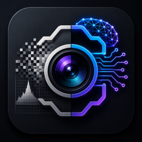
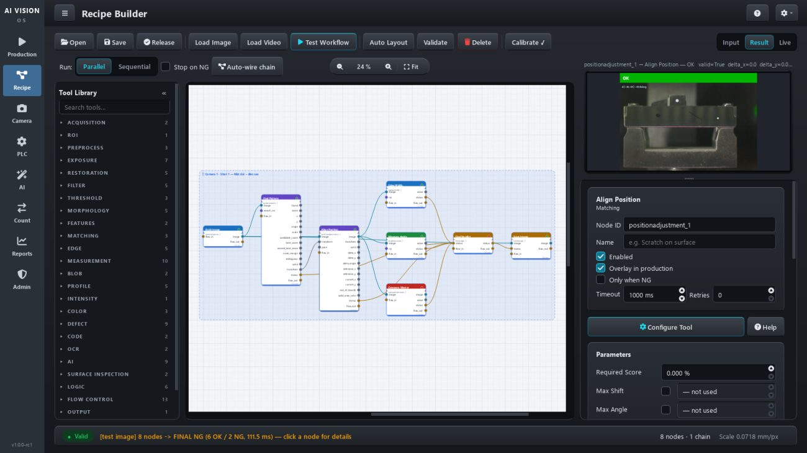
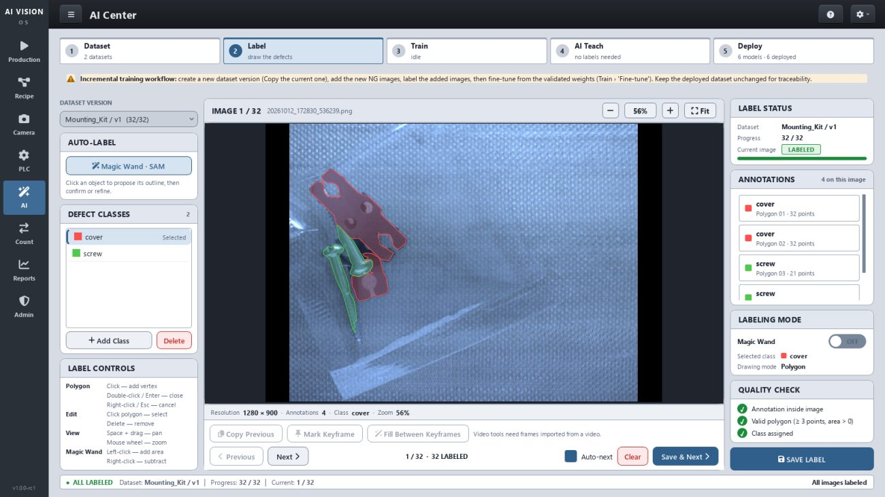
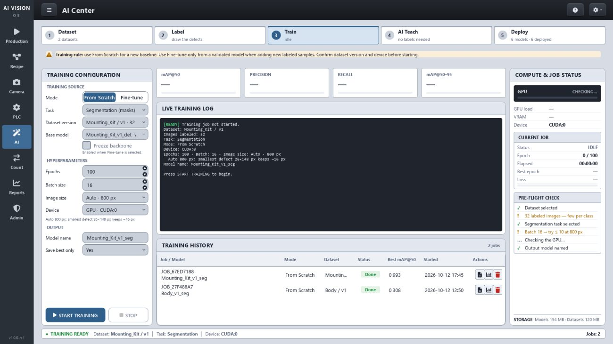
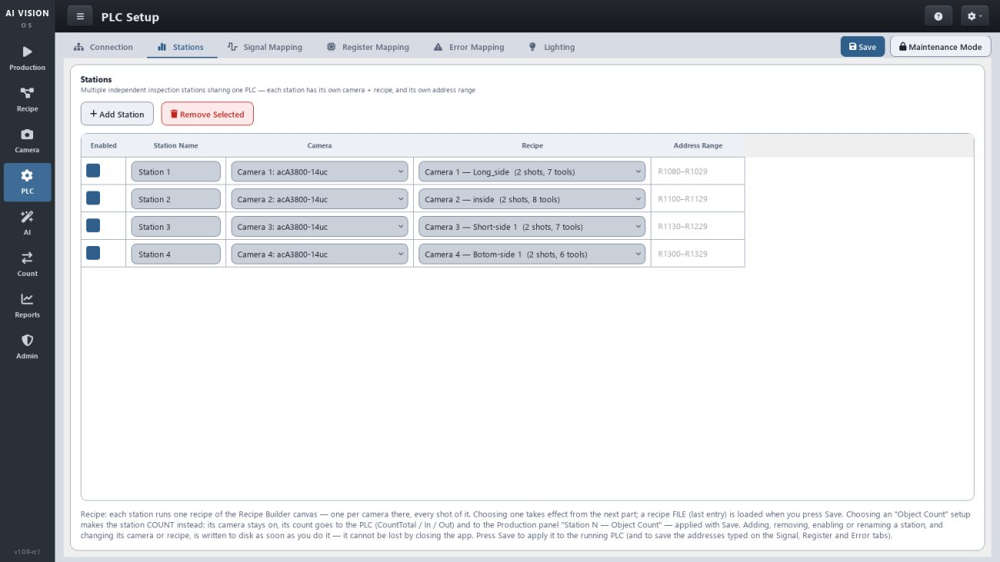

<div align="center">



# AI Vision OS

**Visual inspection software for production lines: drag‑and‑drop workflows, cameras, PLCs and AI in one application.**


[Tiếng Việt](README.md) · **English**

🌐 **Website:** https://hntan0104.github.io/AI-Vision-OS/?lang=en



</div>

---

With AI Vision OS, engineers build an **inspection recipe** for each product by
dragging tools into a graph, **with no code**:

```
PLC trigger → Capture (multiple shots, multiple lights) → Locate → Measure / find defects / AI
            → OK/NG verdict → Result to the PLC → Save image + data
```

One PC runs **up to 4 inspection stations**, each with its own camera and recipe,
all sharing one PLC.

## Main features

| Screen | What it does |
|---|---|
| **Production** | Operator screen: image and OK/NG result per station and per shot; output statistics, defect Pareto chart; automatic layout. |
| **Recipe Builder** | Build the workflow as a node graph: parallel or sequential, stop on NG, auto‑wiring, graph validation, test on images or video, mm/pixel calibration, recipe versioning. |
| **Camera** | Connect, live view, set exposure / gain / resolution, assign a camera to each station. |
| **PLC** | Connect, map signals / registers / error codes, switch lighting per shot, maintenance mode, auto‑reconnect. |
| **AI Center** | A 5‑step flow, **Dataset → Label → Train → AI Teach → Deploy**: semi‑automatic labelling with *Magic Wand* (SAM), YOLO training (detect / segment / classify), fine‑tuning, and AI Teach with no labelling at all. |
| **Object Count** | Count objects with AI + tracking: line or zone counting, in / out, counts sent to the PLC, CSV / JSON / report export. |
| **Reports** | Inspection history, defect Pareto, SPC (Cpk), CSV export. |
| **Admin** | Audit log, backup and restore. |

Also:
- **Built‑in user manual** (Vietnamese), also available as PDF / DOCX.
- **Calibration:** mm/pixel scale, line calibration, servo, stereo (3D pose).
- **AI works without a GPU:** with an NVIDIA GPU it uses CUDA; without one it runs on the CPU.
- **One recipe works on both Windows and Linux.**

<table>
<tr>
<td width="50%"><br><sub><b>AI Center:</b> polygon labelling with Magic Wand (SAM)</sub></td>
<td width="50%"><br><sub><b>AI Center:</b> YOLO training with mAP / precision / recall</sub></td>
</tr>
<tr>
<td width="50%"><br><sub><b>Multiple shots and lights:</b> each shot has its own tool chain</sub></td>
<td width="50%"><br><sub><b>A whole line on one canvas:</b> 36 nodes, 8 chains</sub></td>
</tr>
<tr>
<td colspan="2" align="center"><br><sub><b>PLC Setup:</b> 4 stations, each with one camera and one recipe</sub></td>
</tr>
</table>

## Tool library

**126 tools** covering every inspection step:

| Group | Tools |
|---|---|
| **AI** (9) | AI Detect, AI Segment, AI Classify, AI Anomaly, AI Heat Map, AI Search, AI Count, AI Piece Count, AI Font (custom‑trained OCR) |
| **Measurement** (14) | Caliper, Outer Size, Edge Gap, Gap (2 ROI), Gap Profile, Measure Angle, Angle (2 ROI / 2 Seg), Corner Angle, Hex Angle, Lug Position, Area Check, Blob Area, Blob Stats |
| **Edge / Profile** (10) | Edge Position, Edge Width, Edge Pitch, Edge Pairs, Edge Angle; Profile Position, Profile Width, Profile Peak, Peak Width, Profile Defect |
| **Defect** (18) | Surface Defect, Surface Check, Contour Defect, Multi‑Profile Defect, Compare Master, Crack Tracer, Edge Integrity, Hole Check, Pin Alignment, Assembly Check, Print Verify, Reflection Check, Strand Check, Texture Check, Statistical Check, Feature Check, Dent Check, Dent Detector |
| **Positioning** (7) | Find Pattern, Find Shape, Find Contour (3 modes), Track Pattern, Align Position |
| **Color / Code / OCR** (7) | Color Check, Color Defect, Color Groups, Read Barcode, Read 2D Code (QR, DataMatrix), Read Text, Read Text 2 |
| **3D** (4) | 3D Flatness, 3D Bumps, 3D Compare, Plate Pose (3D) |
| **Blob / Threshold / Morphology** (10) | Blobs (Binary / Gray), Threshold, Auto Threshold, Dual Threshold, Morphology, Drop Specks, Fill Holes, Skeleton, Top‑Hat |
| **Image preprocessing** (26) | Exposure, Filter, Restoration, Preprocess (incl. Light Fusion, merging images taken under different lights), Features, Brightness, ROI Box, Grab / Open Image |
| **Logic / Flow** (20) | Judge, Judge Defects, Zone Judge, Defect Classifier, Calculate, Trend Watch, Final Verdict; Branch OK/NG, Switch / Case, Loop, Parallel, Group, Wait, Stop, Break |
| **Output** (1) | Save Image: by OK/NG, by date / shift / station |

## Real‑world performance

Measured on a running production line, Sep–Oct 2026: 4 stations, two pictures per product face (bright and dark lighting).
PC: Dell Precision 7680, NVIDIA RTX 2000 Ada Laptop GPU 8 GB. Cameras: 4 × Basler acA3800‑14uc (10 MP, USB3). PLC: Panasonic FP7.

| Metric | Result |
|---|---|
| Trigger → Ready per face (2 pictures and every tool) | **~400 ms** |
| Table may move after Trigger (Busy turns on once pictures are taken) | **~230 ms** |
| Every tool of one face (while the table turns) | **~95 ms** |
| One picture through YOLO segmentation, end to end, on the GPU | **~12 ms** |
| YOLOv8n‑seg network: 1 picture / 4 pictures (CUDA graph) | 2.0 ms / 6.8 ms (was 28.4 ms for 1) |
| AI after the line idles 12–30 s | 26–28 ms (no more ~0.9 s GPU wake‑up) |
| One picture at 1918×1372 / full 3840×2748 | ~58 ms / 112–122 ms |
| Find Shape / Compare Master | ~14 ms / 11.4 ms |
| One PLC command (FP7, Ethernet) | ~4.6 ms |
| Saving a 10 MP PNG | ~320 ms, in the background: 0 ms on the cycle |

Actual times depend on the camera, resolution and the tools in the recipe. A trial on your own product pictures is the best guide.

## Handling hard cases

Defects a plain brightness threshold misses. These tools were built on real line pictures.

| Problem | Approach | Tool |
|---|---|---|
| Black glossy plastic: sinks and warps invisible in the picture | Reads the lamp's reflection in the glossy face: flat gives a straight, even band; a sink bends, narrows or breaks it | Reflection Check |
| A shape fault, or just a colour mark (gas, flow)? | 3–4 pictures lit from different sides (photometric stereo): a dent changes with lamp direction, a colour mark doesn't | Light Fusion |
| Short shots and flash among harmless gas marks | Compares outline and roughness with good parts, which gloss and lamp angle don't change | Edge Integrity, Surface Check |
| Hairline cracks 1–4 px wide that fade in and out | Looks for thin lines, not dark pixels, and follows them along their length; dust is not a crack | Crack Tracer |
| Dents on a grainy cast face under striped light | Finds the dent by its sharp, long, curved rim, unlike the stripes and the grain | Dent Detector |
| Parts that shift and rotate | Locates by shape (little affected by lighting), with angle, scale, sub‑pixel; every region follows the part | Find Shape, Align Position |
| Every area varies differently (edges, print, highlights) | Learns from 10–30 good parts, a limit for every pixel | Statistical Check |
| Not enough defect pictures to train AI | The AI learns from OK pictures only; a heat map shows the anomaly and its area (mm²) | AI Anomaly, AI Teach |
| Bent, short or missing pins; partly filled holes | Measures each pin: bend, length, tip position. Holes: centre and diameter to 0.1 px | Pin Alignment, Hole Check |

## Production reliability

- **No lost Triggers:** a Trigger that arrives before Ready is held and handled the moment Ready returns.
- **No blurred pictures:** Busy turns on only after every picture is taken, so the table never moves mid‑capture.
- **Dark‑picture warning:** a lit shot that comes out dark (failed or missed lamp) is flagged at once.
- **Camera loss reported to the PLC:** Error with an error code, cleared automatically when the camera is back.
- **PLC auto‑reconnect** every 2 seconds, clearing stale outputs on reconnect.
- **A slow disk never stops the line:** images are written on a background thread with a bounded queue; the PLC always gets the result first.
- **Per‑cycle log:** a timing line per cycle (Trigger, capture, Busy, verdict, Ready) and PLC link statistics every minute.
- **Over 3,500 automated tests** covering tools, PLCs, cameras and AI.

## System requirements

| | Minimum | Recommended |
|---|---|---|
| OS | Windows 10, 64‑bit | Windows 11, 64‑bit |
| CPU | 4 cores (Intel Core i5 10th gen or equivalent) | 8 cores or more (Core i7 / i9) |
| RAM | 16 GB | 32 GB (AI training, 4 stations) |
| GPU | Optional: AI runs on the CPU, slower | NVIDIA RTX, 8 GB VRAM |
| Storage | SSD, 15 GB free for the software | SSD 512 GB or more for images |
| Camera ports | One USB3 or GigE port per camera | A dedicated USB3 / GigE card per camera |
| PLC link | Ethernet | A dedicated Ethernet port for the PLC |
| NVIDIA Jetson | Jetson Orin, JetPack 6 | 16 GB RAM model or larger |

No internet needed: AI weights ship in the installer. The right configuration depends on camera count, resolution and recipe; get in touch for advice.

- **Compatible cameras:** industrial USB3 Vision / GigE Vision cameras (Basler, FLIR / Teledyne) and USB / UVC cameras. Up to 4 stations per PC, several shots each with different lighting.
- **Compatible PLCs:** KEYENCE, Mitsubishi, Omron and Panasonic over Ethernet, plus any PLC with Modbus TCP. Lighting switched per shot through PLC outputs.

## Licensing and activation

- Each PC uses **one key**, tied to its **Machine ID**. Keys do not expire.
- On first launch the app shows the Machine ID; send it to your supplier to receive a key.
- A key stays valid after a drive replacement or an OS reinstall, but does not work on another PC.

## Contact

For the installer, trial, source code, quote:

> 📧 Email: [hntan0104@gmail.com](mailto:hntan0104@gmail.com)<br>
> 📞 Phone: [+84 822 222 979](tel:+84822222979)

---

<sub>© 2026 hntan0104. Proprietary software, all rights reserved.</sub>
