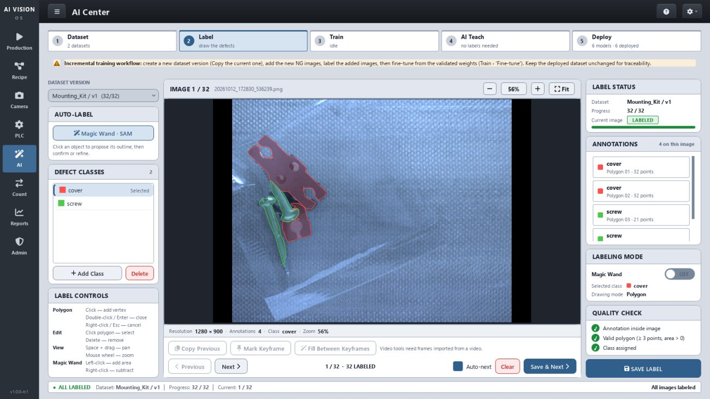

<div align="center">


# AI Vision OS

**Phần mềm kiểm tra ngoại quan cho dây chuyền sản xuất: kéo‑thả quy trình, camera, PLC và AI trong một ứng dụng.**


**Tiếng Việt** · [English](README.en.md)


</div>

---

AI Vision OS giúp kỹ sư dựng **recipe kiểm tra** cho từng sản phẩm bằng cách kéo‑thả
các tool thành sơ đồ, **không cần viết code**:

```
PLC trigger → Chụp ảnh (nhiều shot, nhiều đèn) → Định vị → Đo / tìm lỗi / AI
            → Phán định OK/NG → Trả kết quả cho PLC → Lưu ảnh + dữ liệu
```

Một máy chạy được **tới 4 trạm kiểm tra**, mỗi trạm có camera và recipe riêng, dùng
chung một PLC.

## Tính năng chính

| Màn hình | Chức năng |
|---|---|
| **Production** | Màn hình vận hành: ảnh và kết quả OK/NG theo từng trạm, từng shot; thống kê sản lượng, biểu đồ Pareto lỗi; tự sắp xếp bố cục. |
| **Recipe Builder** | Dựng quy trình bằng sơ đồ node: chạy song song hoặc tuần tự, dừng khi NG, tự nối dây, kiểm tra lỗi sơ đồ, thử trên ảnh hoặc video, hiệu chuẩn mm/pixel, quản lý phiên bản recipe. |
| **Camera** | Kết nối, xem live, chỉnh exposure / gain / độ phân giải, gán camera cho từng trạm. |
| **PLC** | Kết nối, map tín hiệu / thanh ghi / mã lỗi, điều khiển đèn chiếu sáng theo từng shot, chế độ bảo trì, tự kết nối lại. |
| **AI Center** | Quy trình 5 bước **Dataset → Label → Train → AI Teach → Deploy**: gán nhãn bán tự động bằng *Magic Wand* (SAM), huấn luyện YOLO (detect / segment / classify), fine‑tune, AI Teach không cần gán nhãn. |
| **Object Count** | Đếm vật thể bằng AI + tracking: đếm qua đường hoặc trong vùng, đếm vào / ra, gửi số đếm cho PLC, xuất CSV / JSON / báo cáo. |
| **Reports** | Lịch sử kiểm tra, Pareto lỗi, SPC (Cpk), xuất CSV. |
| **Admin** | Nhật ký thao tác (audit log), sao lưu và khôi phục. |

Ngoài ra:
- **Hướng dẫn sử dụng tiếng Việt** tích hợp sẵn trong ứng dụng, có bản PDF / DOCX.
- **Hiệu chuẩn:** tỉ lệ mm/pixel, hiệu chuẩn theo đường, servo, stereo (đo tư thế 3D).
- **AI chạy được không cần GPU:** có GPU NVIDIA thì dùng CUDA, không có thì tự chạy bằng CPU.
- **Một recipe dùng chung cho Windows và Linux.**

<table>
<tr>
<td width="50%"><br><sub><b>AI Center:</b> gán nhãn polygon bằng Magic Wand (SAM)</sub></td>
<td width="50%"><br><sub><b>AI Center:</b> huấn luyện YOLO, theo dõi mAP / precision / recall</sub></td>
</tr>
<tr>
<td width="50%"><br><sub><b>Nhiều shot, nhiều đèn:</b> mỗi shot một chuỗi tool riêng</sub></td>
<td width="50%"><br><sub><b>Cả dây chuyền trên một canvas:</b> 36 node, 8 chuỗi</sub></td>
</tr>
<tr>
<td colspan="2" align="center"><br><sub><b>PLC Setup:</b> 4 trạm, mỗi trạm một camera và một recipe</sub></td>
</tr>
</table>

## Thư viện tool

**126 tool** cho mọi bước kiểm tra:

| Nhóm | Tool |
|---|---|
| **AI** (9) | AI Detect, AI Segment, AI Classify, AI Anomaly, AI Heat Map, AI Search, AI Count, AI Piece Count, AI Font (OCR huấn luyện riêng) |
| **Đo lường** (14) | Caliper, Outer Size, Edge Gap, Gap (2 ROI), Gap Profile, Measure Angle, Angle (2 ROI / 2 Seg), Corner Angle, Hex Angle, Lug Position, Area Check, Blob Area, Blob Stats |
| **Edge / Profile** (10) | Edge Position, Edge Width, Edge Pitch, Edge Pairs, Edge Angle; Profile Position, Profile Width, Profile Peak, Peak Width, Profile Defect |
| **Tìm lỗi** (18) | Surface Defect, Surface Check, Contour Defect, Multi‑Profile Defect, Compare Master, Crack Tracer, Edge Integrity, Hole Check, Pin Alignment, Assembly Check, Print Verify, Reflection Check, Strand Check, Texture Check, Statistical Check, Feature Check, Dent Check, Dent Detector |
| **Định vị** (7) | Find Pattern, Find Shape, Find Contour (3 kiểu), Track Pattern, Align Position |
| **Màu / Mã / OCR** (7) | Color Check, Color Defect, Color Groups, Read Barcode, Read 2D Code (QR, DataMatrix), Read Text, Read Text 2 |
| **3D** (4) | 3D Flatness, 3D Bumps, 3D Compare, Plate Pose (3D) |
| **Blob / Ngưỡng / Hình thái** (10) | Blobs (Binary / Gray), Threshold, Auto Threshold, Dual Threshold, Morphology, Drop Specks, Fill Holes, Skeleton, Top‑Hat |
| **Tiền xử lý ảnh** (26) | Exposure, Filter, Restoration, Preprocess (gồm Light Fusion ghép nhiều ảnh đèn), Features, Brightness, ROI Box, Grab / Open Image |
| **Logic / Luồng** (20) | Judge, Judge Defects, Zone Judge, Defect Classifier, Calculate, Trend Watch, Final Verdict; Branch OK/NG, Switch / Case, Loop, Parallel, Group, Wait, Stop, Break |
| **Output** (1) | Save Image: lưu theo OK/NG, theo ngày / ca / trạm |

## Phần cứng hỗ trợ

| Loại | Hỗ trợ |
|---|---|
| **Camera** | Basler (USB3 / GigE), FLIR / Teledyne, camera USB / UVC, thư mục ảnh (camera ảo để thử) |
| **PLC** | KEYENCE KV‑8000 (Host Link), Panasonic FP7 (MEWTOCOL), Mitsubishi (MC protocol), Omron (FINS), Modbus TCP |
| **Máy tính** | Windows 10/11 x64 (GPU NVIDIA nếu muốn chạy AI bằng GPU) · NVIDIA Jetson Orin với JetPack 6 |

## Bản quyền và kích hoạt

- Mỗi máy dùng **một key**, gắn với **Machine ID** của máy. Key không hết hạn.
- Lần chạy đầu, ứng dụng hiện Machine ID; gửi mã này cho nhà cung cấp để nhận key.
- Key vẫn còn hiệu lực khi thay ổ đĩa hoặc cài lại hệ điều hành, nhưng không dùng được trên máy khác.

## Liên hệ

Để nhận bộ cài đặt, dùng thử, source code hoặc báo giá:

> Gmail: hntan0104@gmail.com
> Phone: +84822222979
> 

---

<sub>© 2026 hntan0104. Phần mềm độc quyền, bảo lưu mọi quyền.</sub>
