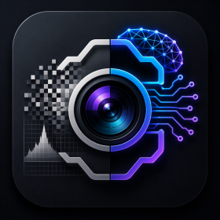
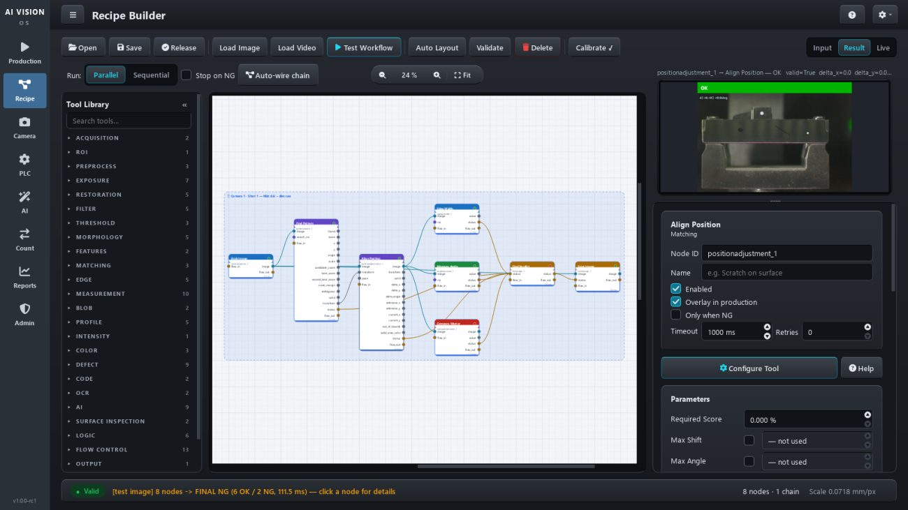
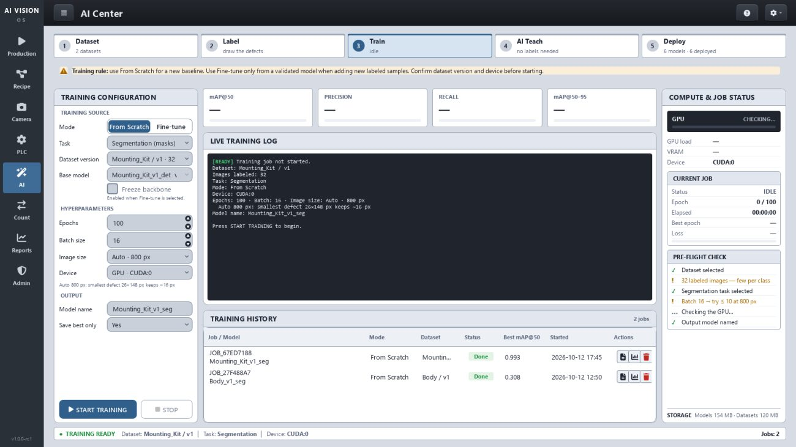
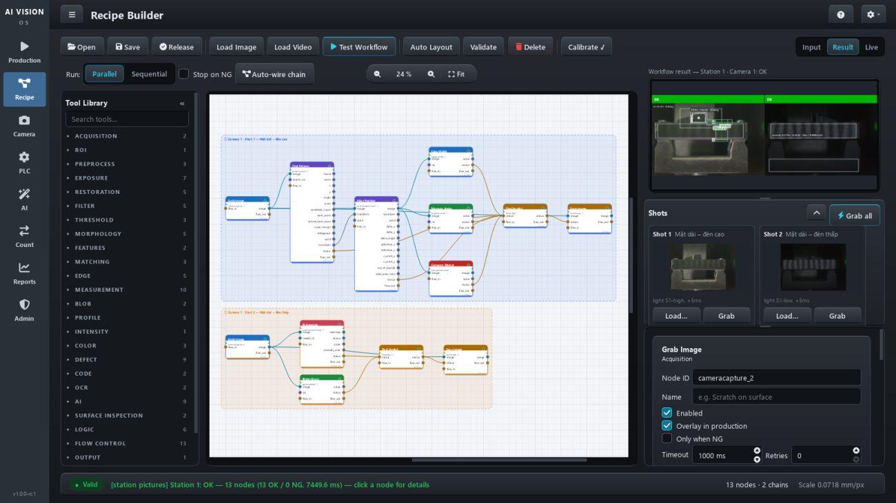
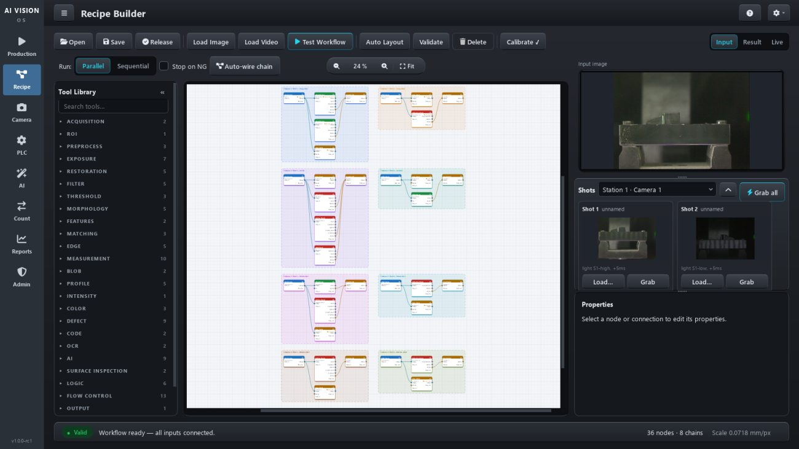
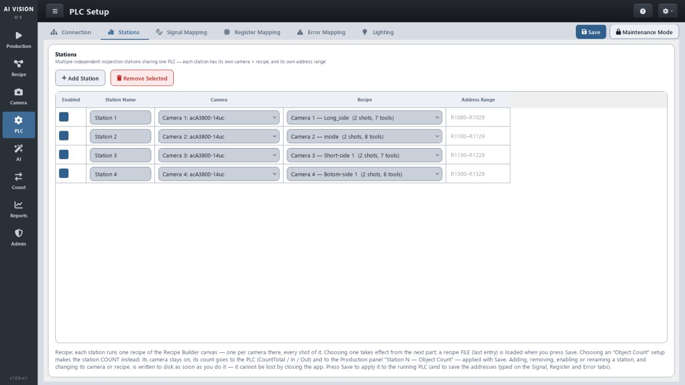

<div align="center">



# AI Vision OS

**Phần mềm kiểm tra ngoại quan cho dây chuyền sản xuất: kéo‑thả quy trình, camera, PLC và AI trong một ứng dụng.**


**Tiếng Việt** · [English](README.en.md)

🌐 **Trang web:** https://hntan0104.github.io/AI-Vision-OS/



</div>

---

AI Vision OS giúp người dùng dựng **recipe kiểm tra** cho từng sản phẩm bằng cách kéo‑thả
các tool thành sơ đồ, **không cần viết code**:

```
PLC trigger → Chụp ảnh (nhiều shot, nhiều đèn) → Định vị → Đo / tìm lỗi / AI
            → Phán định OK/NG → Trả kết quả cho PLC → Lưu ảnh + dữ liệu
```

Một máy chạy được **tới 4 trạm kiểm tra**, mỗi trạm có camera và recipe riêng, dùng
chung một PLC.

## Tính năng chính

| Màn hình | Chức năng |
|---|---|
| **Production** | Màn hình vận hành: ảnh và kết quả OK/NG theo từng trạm, từng shot; thống kê sản lượng, biểu đồ Pareto lỗi; tự sắp xếp bố cục. |
| **Recipe Builder** | Dựng quy trình bằng sơ đồ node: chạy song song hoặc tuần tự, dừng khi NG, tự nối dây, kiểm tra lỗi sơ đồ, thử trên ảnh hoặc video, hiệu chuẩn mm/pixel, quản lý phiên bản recipe. |
| **Camera** | Kết nối, xem live, chỉnh exposure / gain / độ phân giải, gán camera cho từng trạm. |
| **PLC** | Kết nối, map tín hiệu / thanh ghi / mã lỗi, điều khiển đèn chiếu sáng theo từng shot, chế độ bảo trì, tự kết nối lại. |
| **AI Center** | Quy trình 5 bước **Dataset → Label → Train → AI Teach → Deploy**: gán nhãn bán tự động bằng *Magic Wand* (SAM), huấn luyện YOLO (detect / segment / classify), fine‑tune, AI Teach không cần gán nhãn. |
| **Object Count** | Đếm vật thể bằng AI + tracking: đếm qua đường hoặc trong vùng, đếm vào / ra, gửi số đếm cho PLC, xuất CSV / JSON / báo cáo. |

Ngoài ra:
- **Hướng dẫn sử dụng tiếng Việt** tích hợp sẵn trong ứng dụng, có bản PDF / DOCX.
- **Hiệu chuẩn:** tỉ lệ mm/pixel
- **Một recipe dùng chung cho Windows và Linux.**
- ** Có 

<table>
<tr>
<td width="50%"><br><sub><b>AI Center:</b> gán nhãn polygon bằng Magic Wand (SAM)</sub></td>
<td width="50%"><br><sub><b>AI Center:</b> huấn luyện YOLO, theo dõi mAP / precision / recall</sub></td>
</tr>
<tr>
<td width="50%"><br><sub><b>Nhiều shot, nhiều đèn:</b> mỗi shot một chuỗi tool riêng</sub></td>
<td width="50%"><br><sub><b>Cả dây chuyền trên một canvas:</b> 36 node, 8 chuỗi</sub></td>
</tr>
<tr>
<td colspan="2" align="center"><br><sub><b>PLC Setup:</b> 4 trạm, mỗi trạm một camera và một recipe</sub></td>
</tr>
</table>

## Thư viện tool

**126 tool** cho mọi bước kiểm tra:

| Nhóm | Tool |
|---|---|
| **AI** (9) | AI Detect, AI Segment, AI Classify, AI Anomaly, AI Heat Map, AI Search, AI Count, AI Piece Count, AI Font (OCR huấn luyện riêng) |
| **Đo lường** (14) | Caliper, Outer Size, Edge Gap, Gap (2 ROI), Gap Profile, Measure Angle, Angle (2 ROI / 2 Seg), Corner Angle, Hex Angle, Lug Position, Area Check, Blob Area, Blob Stats |
| **Edge / Profile** (10) | Edge Position, Edge Width, Edge Pitch, Edge Pairs, Edge Angle; Profile Position, Profile Width, Profile Peak, Peak Width, Profile Defect |
| **Tìm lỗi** (18) | Surface Defect, Surface Check, Contour Defect, Multi‑Profile Defect, Compare Master, Crack Tracer, Edge Integrity, Hole Check, Pin Alignment, Assembly Check, Print Verify, Reflection Check, Strand Check, Texture Check, Statistical Check, Feature Check, Dent Check, Dent Detector |
| **Định vị** (7) | Find Pattern, Find Shape, Find Contour (3 kiểu), Track Pattern, Align Position |
| **Màu / Mã / OCR** (7) | Color Check, Color Defect, Color Groups, Read Barcode, Read 2D Code (QR, DataMatrix), Read Text, Read Text 2 |
| **3D** (4) | 3D Flatness, 3D Bumps, 3D Compare, Plate Pose (3D) |
| **Blob / Ngưỡng / Hình thái** (10) | Blobs (Binary / Gray), Threshold, Auto Threshold, Dual Threshold, Morphology, Drop Specks, Fill Holes, Skeleton, Top‑Hat |
| **Tiền xử lý ảnh** (26) | Exposure, Filter, Restoration, Preprocess (gồm Light Fusion ghép nhiều ảnh đèn), Features, Brightness, ROI Box, Grab / Open Image |
| **Logic / Luồng** (20) | Judge, Judge Defects, Zone Judge, Defect Classifier, Calculate, Trend Watch, Final Verdict; Branch OK/NG, Switch / Case, Loop, Parallel, Group, Wait, Stop, Break |
| **Output** (1) | Save Image: lưu theo OK/NG, theo ngày / ca / trạm |

## Hiệu năng thực tế

Số đo thực tế: 4 trạm, mỗi mặt sản phẩm chụp 2 ảnh (đèn sáng và đèn tối).
NVIDIA RTX 2000 Ada GPU 8 GB. Camera: 4 × Basler acA3800‑14uc (10 MP, USB3). PLC: Panasonic FP7.

| Chỉ số | Kết quả |
|---|---|
| Trigger → Ready cho một mặt (gồm 2 lần chụp và toàn bộ tool) | **~400 ms** |
| Bàn xoay được sau Trigger (Busy bật ngay khi chụp xong) | **~230 ms** |
| Chạy toàn bộ tool của một lần chụp | **~95 ms** |
| Một ảnh qua AI YOLO segment, đầu cuối, trên GPU | **~12 ms** |
| Mạng YOLOv8n‑seg: 1 ảnh / 4 ảnh (CUDA graph) | 2.0 ms  |
| Chụp 1 ảnh 1918×1372 / full 3840×2748 | ~58 ms |
| Find Shape / Compare Master | ~14 ms |
| Một lệnh PLC (FP7, Ethernet) | ~4.6 ms |
| Lưu ảnh 10 MP PNG | chạy nền: 0 ms trên chu kỳ |

Thời gian thực tế phụ thuộc camera, độ phân giải và số tool trong recipe.

## Xử lý các trường hợp khó

Những lỗi mà ngưỡng sáng tối thông thường bỏ sót. Các tool này được xây dựng từ ảnh thật trên line.

| Bài toán | Cách xử lý | Tool |
|---|---|---|
| Nhựa đen bóng: vết lõm, cong vênh nhìn ảnh không thấy | Đọc vệt đèn phản chiếu trên bề mặt bóng: mặt phẳng cho vệt thẳng đều, chỗ lõm làm vệt cong, hẹp, đứt | Reflection Check |
| Lỗi hình dạng hay chỉ là vết màu (vết khí, vết chảy)? | Chụp 3–4 ảnh với đèn từ các phía (photometric stereo): chỗ lõm đổi sáng tối theo hướng đèn, vết màu thì không | Light Fusion |
| Thiếu liệu, bavia giữa các vết khí vô hại | So đường viền và độ nhám với hàng tốt, thứ mà độ bóng và góc đèn không làm thay đổi | Edge Integrity, Surface Check |
| Vết nứt chân tóc 1–4 px, lúc rõ lúc mờ | Tìm đường mảnh thay vì điểm tối, bám theo cả chiều dài, không nhầm bụi thành lỗi | Crack Tracer |
| Vết móp trên bề mặt đúc, đèn sọc, hạt thô | Nhận ra vết móp nhờ mép sắc, dài, cong của nó, khác với sọc đèn và hạt bề mặt | Dent Detector |
| Sản phẩm lệch vị trí, xoay góc | Định vị theo hình dạng (ít phụ thuộc ánh sáng), có góc, tỉ lệ, sub‑pixel; mọi vùng kiểm tra tự đi theo sản phẩm | Find Shape, Align Position |
| Mỗi vùng dao động khác nhau (cạnh, chữ in, vùng đèn chiếu) | Học 10–30 hàng tốt, mỗi pixel một ngưỡng riêng | Statistical Check |
| Không có đủ ảnh lỗi để huấn luyện AI | AI chỉ học từ ảnh hàng OK; heat map chỉ ra vùng bất thường và diện tích (mm²) | AI Anomaly, AI Teach |
| Chân connector cong, ngắn, thiếu; lỗ bị lấp | Đo từng chân: độ cong, chiều dài, vị trí đầu chân. Lỗ: tâm và đường kính tới 0,1 px | Pin Alignment, Hole Check |

## Ổn định khi chạy sản xuất

- **Không mất Trigger:** Trigger đến khi chưa Ready được giữ lại và xử lý ngay khi Ready.
- **Không ảnh mờ:** Busy chỉ bật khi đã chụp xong mọi ảnh.
- **Báo khi ảnh tối:** ảnh có bật đèn mà ra tối (đèn hỏng, mất đèn) được cảnh báo ngay.
- **Mất camera, PLC biết ngay:** bật Error kèm mã lỗi cho PLC, tự xóa khi camera được cắm lại.
- **Tự kết nối lại PLC** mỗi 2 giây, xóa trạng thái cũ khi kết nối lại.
- **Ổ đĩa chậm không làm dừng line:** ảnh ghi ở luồng nền với hàng đợi giới hạn; PLC luôn nhận kết quả trước.
- **Log từng chu kỳ:** một dòng thời gian cho mỗi chu kỳ (Trigger, chụp, Busy, kết quả, Ready) và thống kê đường truyền PLC mỗi phút.
- **Hơn 3.500 bài kiểm thử tự động** cho tool, PLC, camera và AI.

## Yêu cầu hệ thống

| | Tối thiểu | Khuyến nghị |
|---|---|---|
| Hệ điều hành | Windows 10, 64‑bit | Windows 11, 64‑bit |
| CPU | 4 nhân (Intel Core i5 thế hệ 10 hoặc tương đương) | 8 nhân trở lên |
| RAM | 16 GB | 32 GB (huấn luyện AI, chạy 4 trạm) |
| GPU | Không bắt buộc: AI chạy bằng CPU | NVIDIA RTX, 8 GB VRAM |
| Ổ đĩa | SSD, trống 15 GB cho phần mềm | SSD 512 GB trở lên để lưu ảnh |
| Cổng camera | 1 cổng USB3 hoặc GigE cho mỗi camera | Card USB3 / GigE riêng cho mỗi camera |
| Kết nối PLC | Ethernet | Cổng Ethernet riêng cho PLC |
| NVIDIA Jetson | Jetson Orin, JetPack 6 | Bản 16 GB RAM trở lên |

Không cần internet: trọng số AI có sẵn trong bộ cài. Cấu hình phù hợp phụ thuộc số camera, độ phân giải và recipe; liên hệ để được tư vấn.

- **Camera tương thích:** camera công nghiệp USB3 Vision / GigE Vision (Basler, FLIR / Teledyne) và camera USB / UVC. Tới 4 trạm trên một máy, mỗi trạm nhiều shot với nhiều chế độ đèn.
- **PLC tương thích:** KEYENCE, Mitsubishi, Omron, Panasonic qua Ethernet, và mọi PLC hỗ trợ Modbus TCP. Bật đèn theo từng shot qua ngõ ra PLC.

## Bản quyền và kích hoạt

- Mỗi máy dùng **một key**, gắn với **Machine ID** của máy. Key không hết hạn.
- Lần chạy đầu, ứng dụng hiện Machine ID; gửi mã này cho nhà cung cấp để nhận key.
- Key vẫn còn hiệu lực khi thay ổ đĩa hoặc cài lại hệ điều hành, nhưng không dùng được trên máy khác.

## Liên hệ

Để nhận bộ cài đặt, dùng thử, source code hoặc báo giá:

> 📧 Email: [hntan0104@gmail.com](mailto:hntan0104@gmail.com)<br>
> 📞 Phone: [+84 822 222 979](tel:+84822222979)

---

<sub>© 2026 hntan0104. Phần mềm độc quyền, bảo lưu mọi quyền.</sub>
